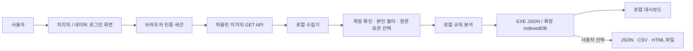

# 데이터 흐름과 보관

운영자 서버로 이어지는 연결은 없습니다. 자동 동기화·AI 요청·자동 업데이트·원격 오류 보고도 없습니다. GitHub는 사용자가 저장소 버튼을 누를 때 외부 브라우저에서 엽니다.

## 로그인과 권한

비밀번호 입력은 네이버 웹페이지에서 이루어집니다. EXE는 `persist:chzzk`의 별도 Chromium 세션을 사용합니다. 확장은 기존 브라우저 세션의 `credentials: include` 요청을 사용하며 `cookies` 권한이 없고 쿠키를 문자열로 읽거나 내보내지 않습니다.

스트리머 수집은 활성 계정 ID를 채널 ID로 사용하고 `my-role = STREAMER`를 확인합니다. 다른 채널의 스튜디오를 임의 지정하지 못합니다. 개인 제한 조회는 본인 ID만 요청하며 일반 시청자 권한으로 거절되면 조회 불가로 처리합니다.

수집 단계 사이, 비공개 스냅샷 전후, 재생 관찰 중 최대 30초마다 계정을 재확인하며 변경되면 중단합니다. 계정 전환 전 수집·측정을 꺼 두면 전환 순간의 기록 혼합을 줄일 수 있습니다.

## 접속 대상

| 대상 | 용도 |
|---|---|
| `api.chzzk.naver.com` | 허용된 개인/스튜디오/다시보기 GET API |
| `comm-api.game.naver.com` | 로그인 계정 확인 |
| 치지직·스튜디오·네이버 로그인 웹페이지 | 사용자가 여는 실제 서비스 화면 |
| `github.com/yeyebee/chzzk-local` | 사용자가 저장소 버튼을 눌렀을 때 |

**프로그램 조회와 치지직 웹페이지의 연결은 다릅니다.** 실제 로그인·방송 웹페이지는 서비스 자체의 영상 CDN·광고·운영 네트워크를 사용합니다. 이 프로그램이 그 웹사이트의 모든 네트워크 사용을 차단하거나 통제한다고 주장하지 않습니다.

조회기는 GET만 허용하고 외부 호스트·알 수 없는 경로·리디렉션을 거절합니다. EXE 대시보드는 HTTP(S)를 차단합니다. 확장 대시보드는 두 API 호스트에만 연결할 수 있고 원격 코드·웹폰트를 로드하지 않습니다.

## 저장 내용

공통: 계정 ID/닉네임, 채널, 수집 결과·커서·집계, 선택한 후원 정보, 관찰한 플레이어 구간. 최소 통계도 시청자 식별자와 활동 흔적을 포함하므로 익명 데이터가 아닙니다.

개인 모드: 내 정상 채팅 원문·시각·채널·다시보기 위치. 다른 사람 원문은 메모리에서 본인 필터링 후 버립니다.

스트리머 모드:

- **최소 통계**: 원문 없이 횟수·글자 수·유형·시간대·날짜·10분 활동 칸·최대 100종의 이모티콘 토큰 등.
- **예시 문장**: 통계 + 200자 이하 정상 채팅 최대 3개(시청자/다시보기별, 상세 집계별), 식별 가능한 후원 메시지 최대 300자.
- **전체 원문**: 한도 안에서 읽은 정상 채팅 본문 전체, 작성자 ID·닉네임, 시각·위치. 전체 원시 API 응답이나 인증 정보가 아닙니다. 상세 메시지는 닉네임/위치가 없을 수 있습니다.

옵션 변경만으로 기존 원문을 제거하지 않습니다. 명시적인 **기존 원문도 삭제**는 다음 수집에서 최소/예시 방식에 맞춰 적용합니다. 최소는 예시·후원 문장도 제거합니다. **보관한 원문만 삭제** 버튼은 재로그인이나 새 조회 없이 원문·예시·후원 문장을 즉시 로컬 저장소에서 제거합니다. 집계와 이후 수집의 보관 방식은 그대로이므로 FULL 설정이면 다음 조회의 새 원문은 다시 저장됩니다. 이미 내보낸 파일은 삭제하지 않습니다. 처음부터 재조회는 해당 집계를 새 데이터로 교체하므로 현재 보관 방식이 적용됩니다.

익명·탈퇴 후원은 개인 순위에 ID를 연결하지 않습니다. 성별·연령은 공식 집계만 사용하며 개인 속성을 추론하지 않습니다. 제한 정보는 명시적인 서버 값만 사용하고 결측과 `false`/`0`을 구분합니다.

## 위치와 삭제

| | EXE | 확장 |
|---|---|---|
| 기록 | `%APPDATA%/my-viewing-log/data/records.json` | 확장 origin의 `chzzk-local` IndexedDB |
| 로그인 | 앱 데이터의 `Partitions/chzzk` | 일반 브라우저의 기존 세션 |
| 저장 | 임시 파일·fsync·rename | IndexedDB 트랜잭션 |
| 연결 해제 | 앱 세션·캐시 삭제, 기록 유지 | 활성 계정·측정 해제, 일반 로그인·기록 유지 |
| 전체 삭제 | 모든 계정 기록·진단과 앱 세션 | 확장 기록·진단만 삭제 |

앱 자체 암호화는 없습니다. 같은 OS 계정/브라우저 프로필 접근 권한이 있는 사람·프로그램이 읽을 수 있습니다. 로그인 세션은 Chromium 보호 방식에 의존합니다. 복구 불가능한 디스크 보안 삭제는 보장하지 않습니다.

FULL은 저장 공간·메모리를 많이 사용합니다. JSON/IndexedDB 스냅샷을 갱신하므로 큰 기록에서 느려질 수 있습니다. 확장은 한 대시보드만 쓰기 잠금을 가지며 탭을 닫으면 수집·관찰이 멈춥니다. 마지막 저장 트랜잭션 이후 소량은 재조회해야 할 수 있습니다.

## 파일 내보내기와 진단

- JSON: 현재 계정의 개인·스트리머 자료, 원문과 시청자 ID 포함. 쿠키/비밀번호는 미포함. 민감한 원문 백업입니다.
- CSV: 본인 채팅. 수식 실행을 줄이도록 위험한 선행 문자를 이스케이프합니다.
- HTML: 기본 닉네임 별칭, 후원 관련 상·금액 제외. 사용자가 이름/후원 포함을 선택할 수 있습니다. ID·원문·실행 스크립트·외부 리소스가 없습니다. 특이한 통계로 재식별될 가능성이 있어 완전 익명화를 보장하지 않습니다.

공유는 사용자가 직접 합니다. 삭제 기능은 내보내기·OS/클라우드 백업까지 지우지 않습니다.

최근 API 요청 500건을 로컬에 보관합니다: 시각·호스트·ID를 제거한 경로·인증 사용 여부·HTTP 상태. 쿼리값·쿠키·헤더·응답 원문은 진단에 저장하지 않습니다. 수집 결과에는 다시보기 번호·오류 단계가 남을 수 있으니 오류 보고 전에 확인하세요.
